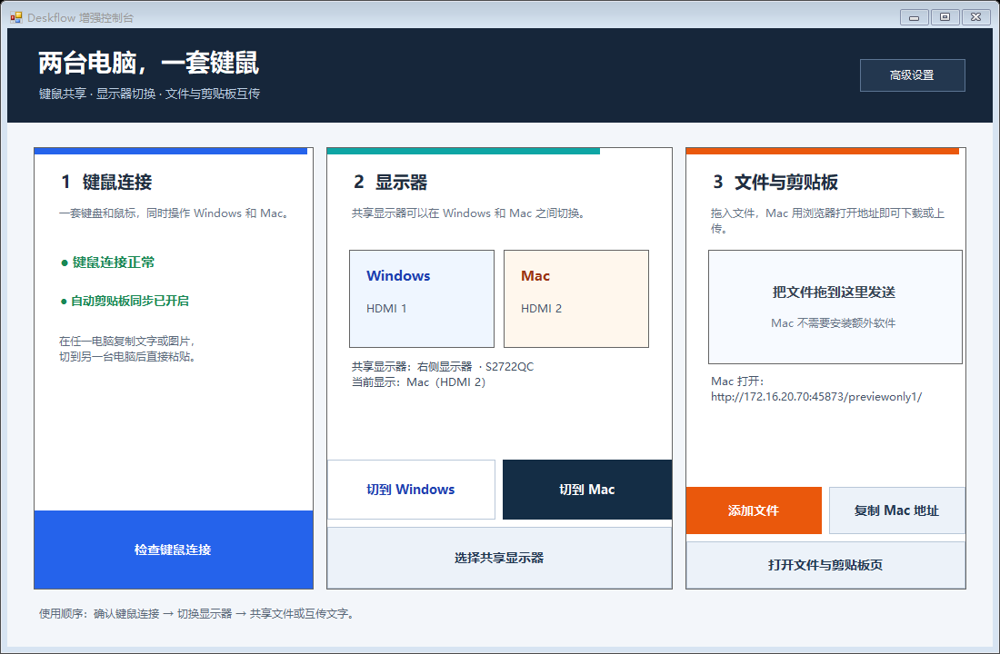

# Deskflow 增强控制台

一个面向 Windows + Mac 双机桌面的简单控制台，用于：

1. 查看 Deskflow 键鼠连接状态；
2. 在共享显示器上切换 Windows / Mac 输入；
3. Windows 与 Mac 双向传输文件；
4. 在 Deskflow 自动剪贴板之外，提供文字剪贴板手动互传。



## 当前工作方式

- Windows 主机运行 Deskflow Server 和本控制台；
- Mac 只需安装 Deskflow Client，不需要安装本控制台；
- 键鼠通过 Deskflow 在两台电脑间共享；
- 共享显示器通过 DDC/CI 手动切换输入源；
- Deskflow 正常时自动同步文字、HTML 和图片剪贴板；
- 文件传输和控制台中的文字剪贴板桥接由内置局域网页面完成；
- Mac 使用 Safari 或 Chrome 打开控制台显示的地址即可，不需要额外安装文件传输软件。

当前默认是手动固定模式，不会根据鼠标位置自动切换显示器。

Windows 息屏、锁屏或睡眠恢复后，控制台会自动重新识别共享显示器；每次切换前也会刷新显示器连接，不再依赖恢复前的旧设备句柄。若共享屏仍处于完全断电状态，先移动鼠标或按键盘唤醒，再点击切换。

## 快速使用

运行：

```text
dist/Deskflow增强控制台.exe
```

主页只有三个编号区域：

1. **键鼠连接**：显示连接和 Deskflow 剪贴板状态；
2. **显示器**：切到 Windows、切到 Mac，或重新选择共享显示器；
3. **文件与剪贴板**：拖入或添加文件，复制 Mac 访问地址；Mac 浏览器打开后即可下载或上传文件，并可使用文字剪贴板互传。

### Windows 发给 Mac

1. 把文件拖到主页第 3 区，或点击 **添加文件**；
2. 点击 **复制 Mac 地址**；
3. 在 Mac 的 Safari / Chrome 中打开该地址；
4. 在“从 Windows 下载”中点击文件即可下载。

### Mac 发给 Windows

1. 在 Mac 浏览器打开同一地址；
2. 在“发送文件到 Windows”中选择或拖入文件；
3. 文件会保存到 Windows 的 `下载\Deskflow Companion`；
4. 可在控制台点击 **打开接收文件夹**。

### 复制粘贴

Deskflow 正常时会自动同步文字、HTML 和图片。若需要手动互传文字，在 Mac 的传输页使用“文字剪贴板”区域：

- **取 Windows 剪贴板**：把 Windows 文字带到 Mac；
- **发送到 Windows 剪贴板**：把 Mac 文字写入 Windows 剪贴板。

详细说明：

- [Windows 使用说明](docs/Deskflow增强控制台使用说明.md)
- [Mac 接入说明](docs/Mac端接入说明.md)

## 下载

仓库的 `dist` 目录包含：

- `Deskflow增强控制台.exe`
- `Deskflow增强控制台-v1.1-win-x64.zip`

Mac 端 Deskflow 安装包请从 Deskflow 官方发布页下载。本仓库不包含 Deskflow 本身的源代码或安装包。

## 从源码编译

在 Windows PowerShell 中运行：

```powershell
.\build.ps1
```

项目使用系统自带的 .NET Framework 4.x C# 编译器，不需要额外安装 .NET SDK。

## 技术说明

- 程序使用 Windows DDC/CI 控制显示器输入源；
- 显示器必须在 OSD 中启用 DDC/CI；
- 某些显示器在未选中某个输入时可能不接受该输入的 DDC/CI 命令；
- 内置传输服务使用局域网 HTTP，默认端口 `45873`，地址中包含随机访问令牌；
- 传输页没有 HTTPS，请只在可信的专用局域网中使用，不要把完整地址发布到公网。

## 目录结构

```text
src/       C# 源码和局域网传输服务
dist/      可执行程序和发布压缩包
docs/      使用说明
assets/    截图和内嵌的 Mac 传输页面
build.ps1  本地编译脚本
```
